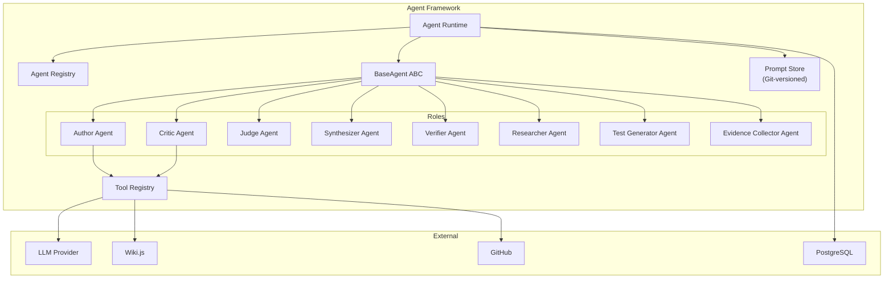
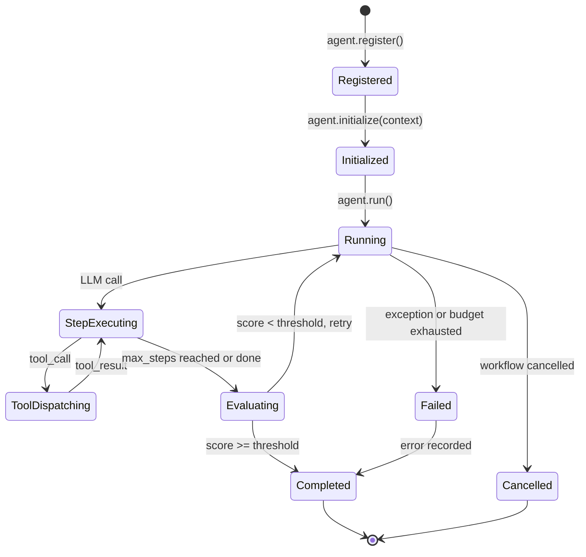
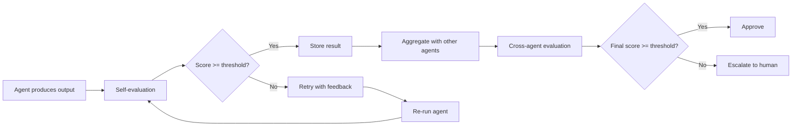

# Agent System Design

**Phase:** 1 — Target Architecture
**Date:** 2026-07-13
**Status:** Complete

---

## 1. Agent Architecture Overview



---

## 2. BaseAgent Interface

```python
from abc import ABC, abstractmethod
from dataclasses import dataclass, field
from typing import Any
from uuid import UUID, uuid4


@dataclass
class AgentContext:
    """Immutable context passed to an agent step."""
    workflow_id: UUID
    work_package_id: UUID
    step_index: int
    shared_state: dict[str, Any]          # mutable shared between steps
    previous_results: list[dict[str, Any]] # results from prior steps
    policy_constraints: list[str]          # active policy IDs
    budget_remaining: float               # USD remaining for this workflow


@dataclass
class AgentResult:
    """Structured output from an agent step."""
    agent_role: str
    findings: list[dict[str, Any]]         # structured findings
    score: float                           # quality score 0.0–1.0
    tokens_used: int
    cost_usd: float
    model_used: str
    duration_ms: int
    metadata: dict[str, Any] = field(default_factory=dict)


class BaseAgent(ABC):
    """Abstract base class for all specialized agents."""

    @property
    @abstractmethod
    def role(self) -> str:
        """Unique agent role identifier (e.g., 'author', 'critic')."""

    @property
    @abstractmethod
    def permissions(self) -> list[str]:
        """List of tool permissions this agent may use."""

    @property
    @abstractmethod
    def prohibited_actions(self) -> list[str]:
        """List of actions this agent must never perform."""

    @property
    @abstractmethod
    def max_steps(self) -> int:
        """Maximum LLM conversation steps before forced termination."""

    @abstractmethod
    def system_prompt(self, context: AgentContext) -> str:
        """Generate the system prompt for this agent, incorporating context."""

    @abstractmethod
    def tools(self) -> list[dict[str, Any]]:
        """Return the tool schemas this agent may call."""

    @abstractmethod
    def evaluate_output(self, result: AgentResult) -> float:
        """Self-evaluation score for this agent's output (0.0–1.0)."""
```

---

## 3. Agent Roles

### 3.1 Author Agent

| Attribute | Value |
|---|---|
| **Role** | `author` |
| **Responsibility** | Generate initial content, documentation, or analysis |
| **Permissions** | `wiki.read`, `wiki.create_page`, `wiki.update_page`, `git.read` |
| **Prohibited** | `wiki.delete_page`, `workflow.approve` |
| **Max steps** | 10 |
| **Evaluation criteria** | Completeness, accuracy, adherence to template, citation count |
| **Input** | Requirements, source material, templates |
| **Output** | Draft content, structured findings |

### 3.2 Critic Agent

| Attribute | Value |
|---|---|
| **Role** | `critic` |
| **Responsibility** | Review content for quality, accuracy, and policy compliance |
| **Permissions** | `wiki.read`, `git.read` |
| **Prohibited** | `wiki.create_page`, `wiki.update_page`, `wiki.delete_page` |
| **Max steps** | 8 |
| **Evaluation criteria** | Issue detection rate, false positive rate, severity classification |
| **Input** | Draft content, policies, reference material |
| **Output** | Issues list with severity, suggestions, score |

### 3.3 Judge Agent

| Attribute | Value |
|---|---|
| **Role** | `judge` |
| **Responsibility** | Make final quality decisions on content or findings |
| **Permissions** | `wiki.read`, `git.read` |
| **Prohibited** | `wiki.create_page`, `wiki.update_page`, `wiki.delete_page` |
| **Max steps** | 5 |
| **Evaluation criteria** | Decision consistency, reasoning quality, alignment with criteria |
| **Input** | Content, critic findings, evaluation criteria |
| **Output** | Pass/fail decision with reasoning |

### 3.4 Synthesizer Agent

| Attribute | Value |
|---|---|
| **Role** | `synthesizer` |
| **Responsibility** | Combine findings from multiple agents into coherent output |
| **Permissions** | `wiki.read`, `wiki.create_page`, `wiki.update_page`, `git.read`, `git.write` |
| **Prohibited** | `wiki.delete_page` |
| **Max steps** | 8 |
| **Evaluation criteria** | Coherence, completeness, no information loss, proper attribution |
| **Input** | Multiple agent results, templates |
| **Output** | Synthesized document, summary |

### 3.5 Verifier Agent

| Attribute | Value |
|---|---|
| **Role** | `verifier` |
| **Responsibility** | Verify that claims in content are supported by evidence |
| **Permissions** | `wiki.read`, `git.read`, `db.read` |
| **Prohibited** | `wiki.create_page`, `wiki.update_page`, `wiki.delete_page` |
| **Max steps** | 6 |
| **Evaluation criteria** | Citation accuracy, evidence-to-claim ratio, verifiability |
| **Input** | Content, evidence sources |
| **Output** | Verification report with citations |

### 3.6 Researcher Agent

| Attribute | Value |
|---|---|
| **Role** | `researcher` |
| **Responsibility** | Gather information from multiple sources |
| **Permissions** | `wiki.read`, `git.read`, `db.read` |
| **Prohibited** | `wiki.create_page`, `wiki.update_page`, `wiki.delete_page`, `git.write` |
| **Max steps** | 12 |
| **Evaluation criteria** | Source diversity, relevance, completeness, freshness |
| **Input** | Research questions, source hints |
| **Output** | Research findings with sources |

### 3.7 Test Generator Agent

| Attribute | Value |
|---|---|
| **Role** | `test_generator` |
| **Responsibility** | Generate test cases from requirements or code |
| **Permissions** | `wiki.read`, `git.read`, `git.write`, `db.read` |
| **Prohibited** | `wiki.create_page`, `wiki.update_page`, `wiki.delete_page` |
| **Max steps** | 10 |
| **Evaluation criteria** | Test coverage, edge case detection, assertion quality |
| **Input** | Requirements, code, existing tests |
| **Output** | Test files, coverage report |

### 3.8 Evidence Collector Agent

| Attribute | Value |
|---|---|
| **Role** | `evidence_collector` |
| **Responsibility** | Collect and organize evidence for findings |
| **Permissions** | `wiki.read`, `git.read`, `db.read`, `db.write` |
| **Prohibited** | `wiki.create_page`, `wiki.update_page`, `wiki.delete_page`, `git.write` |
| **Max steps** | 8 |
| **Evaluation criteria** | Evidence completeness, source quality, organization |
| **Input** | Findings, evidence requirements |
| **Output** | Evidence package with sources and citations |

---

## 4. Agent Lifecycle



### Lifecycle hooks

| Hook | When | Purpose |
|---|---|---|
| `on_register` | Agent added to registry | Validate configuration |
| `on_initialize` | Before first step | Load prompt, set up tools |
| `on_step_start` | Before each LLM call | Log, check budget |
| `on_step_complete` | After each LLM call | Log tokens, cost |
| `on_tool_call` | Before tool execution | Policy check, audit log |
| `on_tool_result` | After tool execution | Store result, update state |
| `on_complete` | After final step | Store findings, emit event |
| `on_error` | On exception | Log error, store failure record |

---

## 5. Prompt Management

### 5.1 Prompt structure

```
prompts/
├── author/
│   ├── v1/
│   │   ├── system.md          # System prompt
│   │   ├── tools.yaml         # Tool selection for this role
│   │   └── evaluation.yaml    # Self-evaluation criteria
│   └── v2/
│       └── ...
├── critic/
│   └── v1/
│       ├── system.md
│       └── ...
└── ...
```

### 5.2 Prompt versioning rules

1. Every prompt change creates a new version directory (`v1/` → `v2/`).
2. The active version is tracked in `policies/agents/<role>.yaml`.
3. Rollback is `git revert` on the policies file.
4. A/B testing is supported by routing a percentage of requests to different versions.

### 5.3 System prompt template

```markdown
You are the **{role_name}** agent in the Wiki Intelligence Platform.

## Your Role
{role_description}

## Permissions
You may use these tools: {permissions_list}

## Prohibited Actions
You must never: {prohibited_list}

## Current Context
Workflow: {workflow_id}
Step: {step_index} of {max_steps}
Budget remaining: ${budget_remaining}

## Instructions
{task_specific_instructions}

## Output Format
Return your findings as a JSON array of objects with fields:
- category: str (e.g., "accuracy", "completeness", "style")
- severity: str ("info", "warning", "critical")
- description: str
- location: str (line number or section reference)
- suggestion: str (optional fix)
```

---

## 6. Tool System

### 6.1 Tool definition

```python
@dataclass
class ToolDefinition:
    name: str
    description: str
    parameters: dict[str, Any]  # JSON Schema
    permissions_required: list[str]
    side_effects: list[str]     # ["wiki.write", "git.write", "db.write"]
    cost_per_call: float        # estimated USD
```

### 6.2 Tool registry

```python
class ToolRegistry:
    """Central registry of all available tools."""

    def __init__(self):
        self._tools: dict[str, ToolDefinition] = {}
        self._handlers: dict[str, Callable] = {}

    def register(self, tool: ToolDefinition, handler: Callable) -> None: ...
    def get(self, name: str) -> tuple[ToolDefinition, Callable]: ...
    def available_for(self, permissions: list[str]) -> list[ToolDefinition]: ...
```

### 6.3 Tool categories

| Category | Tools | Side effects |
|---|---|---|
| **Wiki** | `create_page`, `update_page`, `delete_page`, `fetch_page`, `search_pages`, `browse_tree`, `view_history`, `diff_revisions` | `wiki.write` |
| **Git** | `read_file`, `write_file`, `commit`, `push`, `create_branch`, `diff` | `git.write` |
| **Jira** | `create_issue`, `update_issue`, `link_issue`, `search_issues` | `jira.write` |
| **Database** | `store_finding`, `query_findings`, `store_metric` | `db.write` |
| **Workflow** | `request_approval`, `escalate`, `cancel` | `workflow.write` |

---

## 7. Agent Evaluation

### 7.1 Evaluation dimensions

| Dimension | Weight | Description |
|---|---|---|
| Quality | 0.35 | Accuracy, completeness, coherence of output |
| Cost efficiency | 0.20 | Tokens used vs. value delivered |
| Latency | 0.15 | Time to complete vs. expected |
| Policy compliance | 0.20 | Adherence to agent permissions and policies |
| Tool usage | 0.10 | Correct tool selection, argument validation |

### 7.2 Evaluation flow



### 7.3 Regression capture

When an agent produces a poor result that is corrected:

1. The incorrect output is stored in `evals/regression/`.
2. The correct output is stored alongside it.
3. The pair is added to the regression test corpus.
4. Future agent runs include this case in evaluation.
5. The agent must pass the regression case to be promoted.
