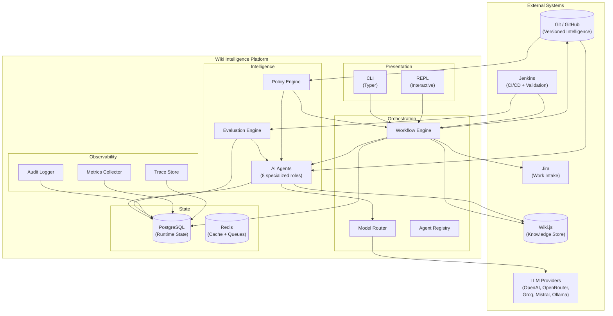
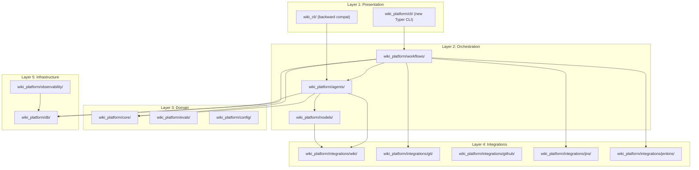

# Architecture Overview

**Phase:** 1 — Target Architecture
**Date:** 2026-07-13
**Status:** Complete
**Maturity target:** Level 5 — Intelligence Platform

---

## 1. Architecture Principles

| # | Principle | Rationale |
|---|---|---|
| AP-1 | **Git defines intelligence** | Prompts, policies, agent definitions, model profiles, and workflow definitions live in version control. Every change is traceable. |
| AP-2 | **Jenkins validates changes** | Every merge to `main` is gated by tests, evals, policy checks, and deployment validation. |
| AP-3 | **PostgreSQL stores runtime state** | Workflow runs, agent runs, findings, approvals, costs, and audit logs live in PostgreSQL. Stateless application servers. |
| AP-4 | **Wiki.js stores knowledge** | Documents, decisions, generated artifacts, and published knowledge live in Wiki.js. |
| AP-5 | **Agents are specialized** | Each agent has a single responsibility, defined permissions, and bounded authority. No god-agents. |
| AP-6 | **Humans approve decisions** | Destructive operations, policy changes, and high-stakes outputs require human sign-off. |
| AP-7 | **Failures become tests** | Every AI failure in production is captured as a regression test. The test corpus grows monotonically. |
| AP-8 | **Traceability is mandatory** | Every artifact can be traced to its source: which agent produced it, which prompt generated it, which model was used, which workflow approved it. |

---

## 2. High-Level Architecture Diagram



---

## 3. Layer Architecture



### Dependency rules

- **Layer N may depend on Layer N and N+1 only.** No upward dependencies.
- **Layer 1 (Presentation)** depends on Orchestration only.
- **Layer 2 (Orchestration)** depends on Domain and Integrations.
- **Layer 3 (Domain)** has zero external dependencies (pure business logic).
- **Layer 4 (Integrations)** depends on external APIs only.
- **Layer 5 (Infrastructure)** depends on databases and observability backends.

---

## 4. Package Structure (Target)

```
wiki-platform/
├── wiki_cli/                          # LAYER 1 — backward compat shim
│   ├── __init__.py                    # Re-exports from wiki_platform
│   ├── client.py                      # Deprecated, re-exports WikiClient
│   ├── models.py                      # Deprecated, re-exports Page models
│   └── ...
├── wiki_platform/                     # NEW — Level 3+ core
│   ├── __init__.py
│   ├── config/                        # LAYER 3 — settings, DI, feature flags
│   │   ├── settings.py                # Pydantic Settings (env + file)
│   │   ├── di.py                      # Dependency injection container
│   │   └── feature_flags.py           # Feature flag evaluation
│   ├── core/                          # LAYER 3 — domain primitives (NO I/O)
│   │   ├── domain.py                  # Value objects, entities
│   │   ├── events.py                  # Domain events
│   │   ├── errors.py                  # Domain error hierarchy
│   │   └── interfaces.py             # Abstract base classes (ports)
│   ├── integrations/                  # LAYER 4 — external system adapters
│   │   ├── wiki/                      # Wiki.js adapter
│   │   │   ├── client.py
│   │   │   ├── models.py
│   │   │   └── queries.py
│   │   ├── git/                       # Git provider abstraction
│   │   │   ├── provider.py
│   │   │   └── github.py
│   │   ├── jira/                      # Jira API wrapper
│   │   │   ├── client.py
│   │   │   └── models.py
│   │   ├── jenkins/                   # Jenkins API wrapper
│   │   │   ├── client.py
│   │   │   └── models.py
│   │   └── llm/                       # LLM provider abstraction
│   │       ├── provider.py
│   │       ├── openai_provider.py
│   │       └── openrouter_provider.py
│   ├── agents/                        # LAYER 2 — agent framework
│   │   ├── base.py                    # Agent ABC
│   │   ├── registry.py               # Agent registry + discovery
│   │   ├── runtime.py                # Agent execution runtime
│   │   ├── roles/                     # Specialized agent implementations
│   │   │   ├── author.py
│   │   │   ├── critic.py
│   │   │   ├── judge.py
│   │   │   ├── synthesizer.py
│   │   │   ├── verifier.py
│   │   │   ├── researcher.py
│   │   │   ├── test_generator.py
│   │   │   └── evidence_collector.py
│   │   ├── tools/                     # Tool definitions + dispatch
│   │   │   ├── registry.py
│   │   │   ├── wiki_tools.py
│   │   │   └── git_tools.py
│   │   └── prompts/                   # Versioned prompts (mirror Git)
│   │       └── ...
│   ├── models/                        # LAYER 2 — model router
│   │   ├── router.py                  # Model selection + fallback
│   │   ├── profiles/                  # Versioned model profiles (YAML)
│   │   ├── pricing.py                 # Cost tracking + budgets
│   │   └── escalation.py             # Escalation rules
│   ├── workflows/                     # LAYER 2 — workflow engine
│   │   ├── engine.py                  # Workflow execution engine
│   │   ├── state_machine.py           # State machine core
│   │   ├── approvals.py               # Human approval gates
│   │   ├── definitions/               # Versioned workflow YAML
│   │   └── transitions/               # Transition guards + actions
│   ├── evals/                         # LAYER 2 — evaluation engine
│   │   ├── runner.py                  # Eval execution
│   │   ├── scorers/                   # Quality scorers
│   │   └── regression/                # Auto-grown regression corpus
│   ├── cli/                           # LAYER 1 — new top-level CLI
│   │   ├── main.py                    # Typer app
│   │   ├── commands/                   # Subcommands
│   │   └── repl.py                    # Interactive REPL
│   └── observability/                 # LAYER 5 — audit + traces
│       ├── audit.py                   # Audit logger
│       ├── metrics.py                 # Metrics collector
│       └── traces.py                  # Trace store
├── policies/                          # VERSIONED — governance policies (Git)
│   ├── agents/
│   ├── workflows/
│   ├── models/
│   └── governance/
├── prompts/                           # VERSIONED — agent prompts (Git)
│   ├── author/
│   ├── critic/
│   └── ...
├── workflows/                         # VERSIONED — workflow definitions (Git)
├── evals/                             # VERSIONED — eval suites (Git)
├── db/                                # SQL migrations + seed
│   └── migrations/                    # alembic
├── tests/
│   ├── unit/
│   ├── integration/
│   ├── workflow/
│   ├── agent/
│   ├── regression/
│   ├── security/
│   ├── eval/
│   └── e2e/
├── reports/                           # Quality, coverage, risk reports
├── docs/
│   ├── discovery/                     # Phase 0
│   ├── architecture/                  # Phase 1
│   ├── migration/                     # Phase 2
│   └── ...
├── pyproject.toml
├── plan.md
└── CHANGELOG.md
```

---

## 5. Key Design Decisions

| Decision | Choice | Rationale |
|---|---|---|
| Language | Python 3.10+ | Existing codebase; ecosystem for AI/ML |
| CLI framework | Typer | Type-safe, Pydantic integration, modern |
| Data models | Pydantic v2 | Already in use; validation + serialization |
| GraphQL client | gql[requests] | Already in use; proven |
| Database | PostgreSQL | Relational state, JSONB for flexible data |
| Migrations | Alembic | De facto standard, reversible |
| Workflow engine | Custom (in-process) | Avoids heavy external dependency (Temporal, Prefect) |
| Agent framework | Custom (in-process) | Lightweight, composable, versioned |
| Model routing | Custom + OpenRouter | Multi-provider, cost-aware, fallback |
| Prompt versioning | Git | "Git defines intelligence" |
| CI/CD | Jenkins | Per core principles |
| Caching | Redis | Workflow locks, LLM response cache |

---

## 6. Cross-Cutting Concerns

### 6.1 Dependency Injection

All I/O is injected via constructor parameters. Domain code (`wiki_platform/core/`) has zero imports from integrations or infrastructure.

```python
# Example: Agent receives dependencies via DI
class AuthorAgent(BaseAgent):
    def __init__(
        self,
        wiki_client: WikiClientInterface,      # injected
        model_router: ModelRouterInterface,     # injected
        policy_engine: PolicyEngineInterface,   # injected
        audit_logger: AuditLoggerInterface,     # injected
    ):
        ...
```

### 6.2 Event Sourcing (Audit)

Every state change emits a domain event:

```python
@dataclass
class WorkflowStarted:
    workflow_id: UUID
    workflow_type: str
    triggered_by: str
    timestamp: datetime
    metadata: dict[str, Any]
```

Events are stored in PostgreSQL and can be replayed for debugging.

### 6.3 Error Handling

Domain errors are typed and hierarchy-based:

```
WikiPlatformError
├── IntegrationError
│   ├── WikiClientError
│   ├── GitError
│   ├── JiraError
│   └── JenkinsError
├── AgentError
│   ├── ToolExecutionError
│   ├── PromptError
│   └── ModelError
├── WorkflowError
│   ├── InvalidTransitionError
│   ├── ApprovalRequiredError
│   └── StateMachineError
├── ValidationError
├── PolicyViolationError
└── AuthenticationError
```

### 6.4 Observability

Every operation emits structured logs:

```json
{
  "trace_id": "abc-123",
  "span_id": "def-456",
  "operation": "agent.run",
  "agent_role": "author",
  "model": "gpt-4o",
  "tokens_in": 1200,
  "tokens_out": 3400,
  "cost_usd": 0.023,
  "duration_ms": 2100,
  "status": "success",
  "workflow_id": "789"
}
```

---

## 7. Maturity Level Mapping

| Level | Components active | Package(s) |
|---|---|---|
| 1 | Wiki.js CLI (CRUD + history) | `wiki_cli/` |
| 2 | + AI assistant (single agent) | `wiki_cli/ai/` |
| 3 | + Multi-agent workflows + state | `wiki_platform/agents/`, `wiki_platform/workflows/` |
| 4 | + Versioned policies + evaluations + approvals | `wiki_platform/evals/`, `policies/`, `prompts/` |
| 5 | + Full integrations (Git, GitHub, Jira, Jenkins, PostgreSQL) | `wiki_platform/integrations/`, `wiki_platform/db/` |

---

## 8. Migration Strategy

The architecture supports incremental migration:

1. **Phase 1–2:** Design only (no code changes).
2. **Phase 3:** Extract `WikiClient` from `wiki_cli/client.py` → `wiki_platform/integrations/wiki/client.py`. Add re-export in `wiki_cli/client.py`.
3. **Phase 4:** Extract models → `wiki_platform/core/`. Add re-exports.
4. **Phase 5:** Build agent framework in `wiki_platform/agents/`. Existing `wiki_cli/ai/agent.py` becomes deprecated wrapper.
5. **Phase 6:** Build workflow engine, model router, DB layer.
6. **Phase 7+:** Integrations, evaluations, observability.

At every step, `wiki_cli/` continues to work via re-exports.
