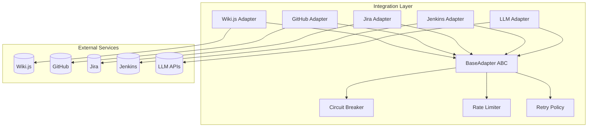

# Integrations Design

**Phase:** 1 — Target Architecture
**Date:** 2026-07-13
**Status:** Complete

---

## 1. Integration Architecture



---

## 2. Base Adapter Interface

```python
from abc import ABC, abstractmethod
from typing import Any
from dataclasses import dataclass
import httpx


@dataclass
class AdapterConfig:
    """Configuration for an external service adapter."""
    base_url: str
    api_key: str
    timeout: int = 30
    max_retries: int = 3
    rate_limit: int = 100  # requests per minute
    circuit_breaker_threshold: int = 5


class BaseAdapter(ABC):
    """Abstract base class for all external service adapters."""

    def __init__(self, config: AdapterConfig):
        self.config = config
        self._client = httpx.AsyncClient(
            base_url=config.base_url,
            headers={"Authorization": f"Bearer {config.api_key}"},
            timeout=config.timeout,
        )
        self._circuit_state = "closed"
        self._failure_count = 0

    @abstractmethod
    async def health_check(self) -> bool:
        """Check if the service is available."""

    @abstractmethod
    async def execute(self, operation: str, **kwargs) -> dict[str, Any]:
        """Execute an operation against the service."""

    async def _request(self, method: str, path: str, **kwargs) -> dict:
        """HTTP request with circuit breaker, retry, and rate limiting."""
        if self._circuit_state == "open":
            raise IntegrationError(f"Circuit breaker open for {self.__class__.__name__}")

        try:
            response = await self._client.request(method, path, **kwargs)
            response.raise_for_status()
            self._failure_count = 0
            return response.json()
        except httpx.HTTPStatusError as e:
            self._failure_count += 1
            if self._failure_count >= self.config.circuit_breaker_threshold:
                self._circuit_state = "open"
            raise IntegrationError(f"HTTP {e.response.status_code}: {e.response.text}")
        except httpx.RequestError as e:
            self._failure_count += 1
            raise IntegrationError(f"Request failed: {e}")
```

---

## 3. Wiki.js Adapter

### 3.1 Interface

```python
class WikiAdapter(BaseAdapter):
    """Wiki.js GraphQL adapter."""

    async def health_check(self) -> bool: ...
    async def execute(self, operation: str, **kwargs) -> dict: ...

    # Page operations
    async def create_page(self, page: PageCreate) -> Page: ...
    async def update_page(self, page_id: int, page: PageUpdate) -> Page: ...
    async def delete_page(self, page_id: int) -> bool: ...
    async def get_page(self, page_id: int) -> Page: ...
    async def get_page_by_path(self, path: str, locale: str = "en") -> Page: ...
    async def list_pages(self, order_by: str = "TITLE") -> list[Page]: ...
    async def search_pages(self, query: str, locale: str = "en") -> list[Page]: ...

    # History operations
    async def get_history(self, page_id: int, offset: int = 0, size: int = 100) -> list[PageHistory]: ...
    async def get_version(self, page_id: int, version_id: int) -> PageVersion: ...
    async def restore_version(self, page_id: int, version_id: int) -> bool: ...

    # Tree operations
    async def browse_tree(self) -> dict: ...
```

### 3.2 GraphQL queries

Queries are stored in `wiki_platform/integrations/wiki/queries/` as separate files:

```
queries/
├── pages/
│   ├── create.graphql
│   ├── update.graphql
│   ├── delete.graphql
│   ├── get_by_id.graphql
│   ├── get_by_path.graphql
│   ├── list.graphql
│   └── search.graphql
└── history/
    ├── get_history.graphql
    ├── get_version.graphql
    └── restore.graphql
```

---

## 4. GitHub Adapter

### 4.1 Interface

```python
class GitHubAdapter(BaseAdapter):
    """GitHub REST/GraphQL adapter."""

    async def health_check(self) -> bool: ...

    # Repository operations
    async def get_file(self, repo: str, path: str, ref: str = "main") -> str: ...
    async def create_file(self, repo: str, path: str, content: str, message: str) -> str: ...
    async def update_file(self, repo: str, path: str, content: str, message: str, sha: str) -> str: ...
    async def delete_file(self, repo: str, path: str, message: str, sha: str) -> bool: ...
    async def list_files(self, repo: str, path: str = "", ref: str = "main") -> list[FileEntry]: ...

    # Commit operations
    async def commit(self, repo: str, files: list[FileChange], message: str) -> str: ...
    async def get_commit(self, repo: str, sha: str) -> Commit: ...
    async def list_commits(self, repo: str, path: str = "", since: datetime | None = None) -> list[Commit]: ...

    # PR operations
    async def create_pr(self, repo: str, title: str, body: str, head: str, base: str = "main") -> PullRequest: ...
    async def get_pr(self, repo: str, number: int) -> PullRequest: ...
    async def list_prs(self, repo: str, state: str = "open") -> list[PullRequest]: ...

    # Branch operations
    async def create_branch(self, repo: str, name: str, from_branch: str = "main") -> str: ...
    async def list_branches(self, repo: str) -> list[str]: ...
```

### 4.2 Rate limit handling

```python
async def _request(self, method: str, path: str, **kwargs) -> dict:
    """Request with GitHub rate limit handling."""
    response = await self._client.request(method, path, **kwargs)

    # Check rate limit headers
    remaining = int(response.headers.get("X-RateLimit-Remaining", 100))
    if remaining < 10:
        reset_at = int(response.headers.get("X-RateLimit-Reset", 0))
        wait_time = max(0, reset_at - time.time())
        if wait_time > 0:
            await asyncio.sleep(wait_time)

    response.raise_for_status()
    return response.json()
```

---

## 5. Jira Adapter

### 5.1 Interface

```python
class JiraAdapter(BaseAdapter):
    """Jira REST API adapter."""

    async def health_check(self) -> bool: ...

    # Issue operations
    async def create_issue(self, project: str, issue_type: str, summary: str, description: str) -> Issue: ...
    async def update_issue(self, issue_key: str, fields: dict) -> Issue: ...
    async def get_issue(self, issue_key: str) -> Issue: ...
    async def search_issues(self, jql: str, max_results: int = 50) -> list[Issue]: ...

    # Link operations
    async def link_issues(self, inward_key: str, outward_key: str, link_type: str) -> bool: ...

    # Transition operations
    async def transition_issue(self, issue_key: str, transition_id: str, comment: str = "") -> bool: ...
    async def get_transitions(self, issue_key: str) -> list[Transition]: ...
```

---

## 6. Jenkins Adapter

### 6.1 Interface

```python
class JenkinsAdapter(BaseAdapter):
    """Jenkins REST API adapter."""

    async def health_check(self) -> bool: ...

    # Pipeline operations
    async def trigger_pipeline(self, job_name: str, parameters: dict | None = None) -> Build: ...
    async def get_build(self, job_name: str, build_number: int) -> Build: ...
    async def get_build_status(self, job_name: str, build_number: int) -> str: ...
    async def wait_for_build(self, job_name: str, build_number: int, timeout: int = 3600) -> Build: ...

    # Queue operations
    async def get_queue(self) -> list[QueueItem]: ...
    async def cancel_queue_item(self, item_id: int) -> bool: ...

    # Job operations
    async def list_jobs(self, folder: str = "") -> list[Job]: ...
    async def get_job_config(self, job_name: str) -> str: ...
```

---

## 7. LLM Adapter

### 7.1 Interface

```python
class LLMAdapter:
    """OpenAI-compatible LLM adapter with multi-provider support."""

    def __init__(self, provider_config: ProviderConfig): ...

    async def chat_completion(
        self,
        messages: list[dict],
        model: str,
        tools: list[dict] | None = None,
        temperature: float = 0.7,
        max_tokens: int = 4096,
        stream: bool = False,
    ) -> ChatCompletion: ...

    async def embedding(
        self,
        texts: list[str],
        model: str,
    ) -> list[list[float]]: ...

    async def health_check(self) -> bool: ...
```

### 7.2 Streaming support

```python
async def chat_completion_stream(
    self,
    messages: list[dict],
    model: str,
    tools: list[dict] | None = None,
) -> AsyncGenerator[ChatChunk, None]:
    """Stream chat completion response chunks."""
    response = await self._client.chat.completions.create(
        model=model,
        messages=messages,
        tools=tools,
        stream=True,
    )
    async for chunk in response:
        yield ChatChunk(
            content=chunk.choices[0].delta.content,
            tool_calls=chunk.choices[0].delta.tool_calls,
            finish_reason=chunk.choices[0].finish_reason,
        )
```

---

## 8. Resilience Patterns

### 8.1 Circuit breaker

```python
class CircuitBreaker:
    """Circuit breaker pattern for external calls."""

    def __init__(self, failure_threshold: int = 5, recovery_timeout: int = 60):
        self.failure_threshold = failure_threshold
        self.recovery_timeout = recovery_timeout
        self.failure_count = 0
        self.state = "closed"  # closed, open, half-open
        self.last_failure_time = None

    async def call(self, func, *args, **kwargs):
        if self.state == "open":
            if time.time() - self.last_failure_time > self.recovery_timeout:
                self.state = "half-open"
            else:
                raise CircuitBreakerOpen()

        try:
            result = await func(*args, **kwargs)
            if self.state == "half-open":
                self.state = "closed"
                self.failure_count = 0
            return result
        except Exception as e:
            self.failure_count += 1
            self.last_failure_time = time.time()
            if self.failure_count >= self.failure_threshold:
                self.state = "open"
            raise
```

### 8.2 Retry with backoff

```python
async def retry_with_backoff(
    func,
    max_retries: int = 3,
    base_delay: float = 1.0,
    max_delay: float = 30.0,
    exponential: bool = True,
):
    """Retry with exponential backoff."""
    for attempt in range(max_retries + 1):
        try:
            return await func()
        except Exception as e:
            if attempt == max_retries:
                raise
            delay = min(base_delay * (2 ** attempt if exponential else 1), max_delay)
            await asyncio.sleep(delay)
```

### 8.3 Rate limiter

```python
class RateLimiter:
    """Token bucket rate limiter."""

    def __init__(self, rate: int, capacity: int):
        self.rate = rate  # tokens per second
        self.capacity = capacity
        self.tokens = capacity
        self.last_refill = time.time()

    async def acquire(self, tokens: int = 1):
        """Acquire tokens, waiting if necessary."""
        while True:
            self._refill()
            if self.tokens >= tokens:
                self.tokens -= tokens
                return
            await asyncio.sleep(0.1)

    def _refill(self):
        now = time.time()
        elapsed = now - self.last_refill
        self.tokens = min(self.capacity, self.tokens + elapsed * self.rate)
        self.last_refill = now
```

---

## 9. Configuration

```yaml
# integrations/config.yaml
wiki:
  url: "${WIKIJS_URL}"
  api_key: "${WIKIJS_API_KEY}"
  timeout: 30
  max_retries: 3
  circuit_breaker_threshold: 5

github:
  token: "${GITHUB_TOKEN}"
  base_url: "https://api.github.com"
  timeout: 30
  rate_limit: 5000  # per hour

jira:
  url: "${JIRA_URL}"
  email: "${JIRA_EMAIL}"
  api_token: "${JIRA_API_TOKEN}"
  timeout: 30

jenkins:
  url: "${JENKINS_URL}"
  username: "${JENKINS_USERNAME}"
  api_token: "${JENKINS_API_TOKEN}"
  timeout: 60

llm:
  openai:
    api_key: "${OPENAI_API_KEY}"
    base_url: "https://api.openai.com/v1"
  openrouter:
    api_key: "${OPENROUTER_API_KEY}"
    base_url: "https://openrouter.ai/api/v1"
  groq:
    api_key: "${GROQ_API_KEY}"
    base_url: "https://api.groq.com/openai/v1"
  mistral:
    api_key: "${MISTRAL_API_KEY}"
    base_url: "https://api.mistral.ai/v1"
  ollama:
    base_url: "http://localhost:11434/v1"
    api_key: "ollama"
```
