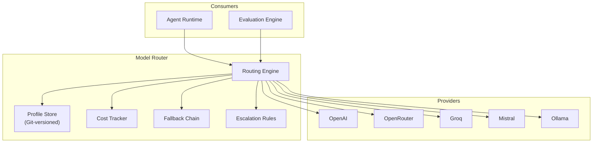
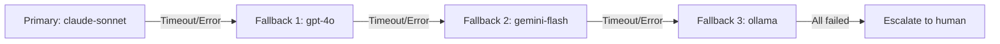

# Model Routing Design

**Phase:** 1 — Target Architecture
**Date:** 2026-07-13
**Status:** Complete

---

## 1. Model Router Overview



---

## 2. Model Profiles

### 2.1 Profile structure

Profiles are stored in `models/profiles/` as YAML files, versioned in Git.

```yaml
# models/profiles/balanced.yaml
name: balanced
description: "Balanced cost/quality for routine tasks"
version: 1

routing:
  primary:
    provider: openrouter
    model: "anthropic/claude-sonnet-4"
    max_tokens: 4096
    temperature: 0.7
    cost_per_1k_input: 0.003
    cost_per_1k_output: 0.015

  fallback:
    - provider: openai
      model: "gpt-4o"
      max_tokens: 4096
      temperature: 0.7
      cost_per_1k_input: 0.005
      cost_per_1k_output: 0.015

    - provider: openrouter
      model: "google/gemini-2.0-flash-001"
      max_tokens: 4096
      temperature: 0.7
      cost_per_1k_input: 0.0001
      cost_per_1k_output: 0.0004

  escalation:
    trigger: "quality_score < 0.7"
    target: "high_quality"
    max_escalations: 2

budgets:
  per_step: 0.10
  per_workflow: 5.00
  per_day: 50.00

limits:
  max_tokens_per_call: 128000
  max_concurrent_calls: 5
  timeout_seconds: 60

evaluation:
  min_quality_score: 0.7
  benchmark_tasks:
    - "summarize_page"
    - "generate_documentation"
    - "review_content"
```

### 2.2 Profile hierarchy

| Profile | Use case | Primary model | Cost/1K tokens |
|---|---|---|---|
| `economy` | Simple lookups, formatting | gemini-flash | $0.0001–$0.0004 |
| `balanced` | Routine tasks, documentation | claude-sonnet | $0.003–$0.015 |
| `high_quality` | Complex analysis, reviews | gpt-4o | $0.005–$0.015 |
| `premium` | Critical decisions, architecture | claude-opus | $0.015–$0.075 |
| `local` | Offline, privacy-sensitive | ollama/llama3 | $0.00 |

---

## 3. Routing Algorithm

```python
class ModelRouter:
    """Selects the optimal model for a given task."""

    def select(
        self,
        task_type: str,
        budget_remaining: float,
        quality_requirement: float = 0.7,
        latency_budget_ms: int = 30000,
        context_tokens: int = 0,
    ) -> ModelSelection:
        """
        Select a model based on:
        1. Task type → required capabilities
        2. Budget → cost ceiling
        3. Quality requirement → minimum model tier
        4. Latency budget → provider speed
        5. Context size → context window requirement
        """
        candidates = self._filter_by_context(context_tokens)
        candidates = self._filter_by_budget(candidates, budget_remaining)
        candidates = self._filter_by_quality(candidates, quality_requirement)
        candidates = self._filter_by_latency(candidates, latency_budget_ms)

        if not candidates:
            return self._escalation_fallback(budget_remaining)

        scored = self._score_candidates(candidates, task_type)
        return scored[0]  # highest score
```

### 3.1 Scoring formula

```
score = (
    w_quality × quality_score +
    w_cost × (1 - normalized_cost) +
    w_latency × (1 - normalized_latency) +
    w_reliability × reliability_score
)

Default weights:
  w_quality = 0.40
  w_cost = 0.25
  w_latency = 0.20
  w_reliability = 0.15
```

### 3.2 Task-type mappings

| Task type | Quality req | Latency budget | Preferred profile |
|---|---|---|---|
| `summarize` | 0.6 | 10s | economy |
| `format` | 0.5 | 5s | economy |
| `draft_content` | 0.7 | 30s | balanced |
| `review_content` | 0.8 | 30s | high_quality |
| `analyze_architecture` | 0.9 | 60s | premium |
| `generate_tests` | 0.7 | 30s | balanced |
| `verify_claims` | 0.8 | 30s | high_quality |
| `make_decision` | 0.9 | 60s | premium |

---

## 4. Fallback Chain

When the primary model fails, the router tries fallback models in order:



### 4.1 Fallback triggers

| Trigger | Action |
|---|---|
| HTTP 429 (rate limit) | Wait and retry, or try next provider |
| HTTP 500 (server error) | Try next provider immediately |
| Timeout | Try next provider immediately |
| Quality score < threshold | Escalate to higher-tier model |
| Budget exhausted | Escalate to human review |

---

## 5. Cost Management

### 5.1 Budget hierarchy

```
Global daily budget
  └── Per-workflow budget
        └── Per-step budget
              └── Per-call budget
```

### 5.2 Cost tracking

Every LLM call is recorded:

```python
@dataclass
class CostRecord:
    id: UUID
    workflow_id: UUID
    agent_role: str
    model: str
    provider: str
    tokens_input: int
    tokens_output: int
    cost_usd: float
    timestamp: datetime
    task_type: str
    quality_score: float | None
```

### 5.3 Cost alerts

| Threshold | Action |
|---|---|
| 50% of daily budget | Log warning |
| 80% of daily budget | Alert admin, reduce to economy profile |
| 100% of daily budget | Block new LLM calls, escalate to human |
| Per-workflow budget exceeded | Stop current workflow, log |

### 5.4 Cost optimization strategies

1. **Caching:** Cache identical prompts (same model + same input) in Redis with 24h TTL.
2. **Batching:** Combine multiple small requests into a single LLM call where possible.
3. **Tiered routing:** Use economy for simple tasks, premium only for critical decisions.
4. **Prompt compression:** Summarize conversation history to reduce token usage.
5. **Local fallback:** Use Ollama for offline/low-stakes tasks.

---

## 6. Provider Configuration

### 6.1 Provider registry

```yaml
# models/providers.yaml
providers:
  openai:
    base_url: "https://api.openai.com/v1"
    api_key_env: "OPENAI_API_KEY"
    rate_limit: 10000  # tokens/min
    models: ["gpt-4o", "gpt-4o-mini", "o1-preview"]

  openrouter:
    base_url: "https://openrouter.ai/api/v1"
    api_key_env: "OPENROUTER_API_KEY"
    rate_limit: 20000
    models: ["anthropic/claude-sonnet-4", "google/gemini-2.0-flash-001"]

  groq:
    base_url: "https://api.groq.com/openai/v1"
    api_key_env: "GROQ_API_KEY"
    rate_limit: 30000
    models: ["llama3-70b-8192", "mixtral-8x7b-32768"]

  mistral:
    base_url: "https://api.mistral.ai/v1"
    api_key_env: "MISTRAL_API_KEY"
    rate_limit: 15000
    models: ["mistral-large-latest", "mistral-small-latest"]

  ollama:
    base_url: "http://localhost:11434/v1"
    api_key: "ollama"
    rate_limit: 999999
    models: ["llama3", "mistral", "codellama"]
```

### 6.2 Provider selection

The router selects providers based on:
1. **Availability:** Health check status
2. **Rate limits:** Current usage vs. limit
3. **Cost:** Provider-specific pricing
4. **Latency:** Historical response times
5. **Capability:** Model-specific features (tool-calling, vision, etc.)

---

## 7. Benchmarking

### 7.1 Benchmark suite

| Task | Metric | Target |
|---|---|---|
| Page summarization | ROUGE-L, cost | score ≥ 0.7, cost ≤ $0.01 |
| Documentation generation | Human rating, completeness | score ≥ 0.8 |
| Content review | Issue detection rate | ≥ 80% of issues found |
| Test generation | Coverage, assertion quality | ≥ 70% coverage |
| Architecture analysis | Reasoning quality | score ≥ 0.85 |

### 7.2 Benchmark schedule

- **Weekly:** Run benchmark suite against all profiles
- **On model change:** Re-benchmark affected profiles
- **On provider change:** Re-benchmark with new provider
- **Results stored in:** `evals/benchmarks/` (Git-tracked)

---

## 8. Escalation Rules

### 8.1 Automatic escalation

| Condition | Action |
|---|---|
| Quality score < 0.5 | Escalate to next tier |
| Quality score < 0.3 after retry | Escalate to premium |
| Budget exhausted at current tier | Escalate to human |
| All providers down | Escalate to human |
| Policy violation detected | Escalate to human |

### 8.2 Manual escalation

Any agent can request escalation via the `escalate` tool:

```python
@dataclass
class EscalationRequest:
    agent_role: str
    reason: str
    context: dict[str, Any]
    suggested_action: str  # "use_higher_model" | "human_review" | "skip"
```

### 8.3 Escalation chain

```
Agent runtime
  → Model router (try higher-tier model)
    → Workflow engine (try different agent)
      → Human reviewer (manual intervention)
        → Admin (policy/config change)
```
