# Release Strategy

**Phase:** 1 — Target Architecture
**Date:** 2026-07-13
**Status:** Complete

---

## 1. Versioning Scheme

### 1.1 Semantic Versioning

```
MAJOR.MINOR.PATCH[-PRERELEASE][+BUILD]
```

| Component | Rule |
|---|---|
| **MAJOR** | Breaking API changes, incompatible workflow format changes, dropped support |
| **MINOR** | New features, new agents, new workflows, deprecation announcements |
| **PATCH** | Bug fixes, performance improvements, documentation updates |
| **PRERELEASE** | `alpha`, `beta`, `rc.1`, `rc.2` |
| **BUILD** | Build metadata (commit hash, timestamp) |

### 1.2 Version mapping to maturity levels

| Version range | Maturity level | Description |
|---|---|---|
| `0.1.0` – `0.9.x` | Level 1–2 | Wiki.js CLI + AI assistant (current) |
| `1.0.0` – `1.4.x` | Level 3 | Multi-agent workflows + state |
| `1.5.0` – `1.9.x` | Level 4 | Versioned policies + evaluations |
| `2.0.0` | Level 5 | Full integration (Jira, Jenkins, PostgreSQL) |

### 1.3 Pre-release convention

```bash
# Alpha: unstable, may break
1.0.0-alpha.1

# Beta: feature-complete, may have bugs
1.0.0-beta.1

# Release candidate: production-ready候选
1.0.0-rc.1

# Stable release
1.0.0
```

---

## 2. Release Process

### 2.1 Release workflow

```mermaid
graph TB
    subgraph "Release Pipeline"
        A[Feature branch] --> B[PR to develop]
        B --> C[CI checks pass]
        C --> D[Code review]
        D --> E[Merge to develop]
        E --> F[Release branch]
        F --> G[Release tests]
        G --> H[Release candidate]
        H --> I[Staging validation]
        I --> J[Release notes]
        J --> K[Merge to main]
        K --> L[Tag release]
        L --> M[Publish to PyPI]
        M --> N[Update changelog]
    end
```



### 2.2 Branch strategy

```
main (stable releases)
  ↑
release/1.0 (release candidates)
  ↑
develop (integration branch)
  ↑
feature/agent-framework (feature branches)
  ↑
bugfix/circuit-breaker (bugfix branches)
```

### 2.3 Release checklist

```markdown
## Release Checklist: v1.0.0

### Pre-release
- [ ] All tests pass on `develop`
- [ ] Coverage meets threshold (≥ 70% overall, ≥ 85% wiki_platform/)
- [ ] No known critical bugs
- [ ] Documentation updated
- [ ] CHANGELOG.md updated
- [ ] Migration notes written (if applicable)
- [ ] Architecture decision records updated

### Release candidate
- [ ] Release branch created
- [ ] Release candidate tagged (v1.0.0-rc.1)
- [ ] Staging environment validated
- [ ] Performance benchmarks pass
- [ ] Security scan passes
- [ ] Regression corpus passes (100%)

### Release
- [ ] Release notes published
- [ ] Main branch merged
- [ ] Git tag created
- [ ] PyPI package published
- [ ] Documentation site updated
- [ ] Deprecation warnings verified (if applicable)

### Post-release
- [ ] Monitoring active for 48 hours
- [ ] No critical issues reported
- [ ] Migration guide available
- [ ] Support channels updated
```

---

## 3. Deprecation Policy

### 3.1 Deprecation timeline

| Phase | Action |
|---|---|
| **Announcement** | Add `DeprecationWarning` + CHANGELOG entry + docs update |
| **One MINOR release** | Warning persists, functionality still works |
| **Next MINOR release** | Remove deprecated functionality |

### 3.2 Deprecation markers

```python
import warnings

def old_function():
    """Deprecated: use new_function() instead."""
    warnings.warn(
        "old_function() is deprecated, use new_function() instead",
        DeprecationWarning,
        stacklevel=2,
    )
    return new_function()
```

### 3.3 Deprecation tracking

```markdown
# CHANGELOG.md

## [1.1.0] - 2026-08-15

### Deprecated
- `wiki_cli.client.WikiJSClient` — use `wiki_platform.integrations.wiki.WikiAdapter` instead
  (will be removed in v1.2.0)
- `wiki_cli.ai.agent.WikiAgent` — use `wiki_platform.agents.runtime.AgentRuntime` instead
  (will be removed in v1.2.0)

### Added
- `wiki_platform.agents` — new agent framework
- `wiki_platform.workflows` — new workflow engine
```

---

## 4. Backward Compatibility

### 4.1 Compatibility matrix

| Component | v0.x (current) | v1.0 | v1.1 | v2.0 |
|---|---|---|---|---|
| `wiki_cli` imports | ✅ Working | ✅ Re-export | ⚠️ Deprecated | ❌ Removed |
| `wiki-cli` CLI command | ✅ Working | ✅ Working | ✅ Working | ⚠️ Deprecated |
| `wiki-ai` CLI command | ✅ Working | ✅ Working | ✅ Working | ⚠️ Deprecated |
| `wiki-platform` CLI | ❌ N/A | ✅ New | ✅ Working | ✅ Primary |
| GraphQL queries | ✅ Working | ✅ Working | ✅ Working | ✅ Working |
| Pydantic models | ✅ Working | ✅ Working | ✅ Working | ⚠️ Extended |
| AI agent | ✅ Single agent | ✅ Single agent | ⚠️ Deprecated | ❌ Removed |

### 4.2 Re-export strategy

```python
# wiki_cli/__init__.py (preserved for backward compat)
"""Backward compatibility shim. Import from wiki_platform instead."""
import warnings

from wiki_platform.integrations.wiki.client import WikiClient as WikiJSClient
from wiki_platform.core.errors import WikiPlatformError as WikiJSError
from wiki_platform.integrations.wiki.models import Page, PageResponse, PageHistory, PageVersion
from wiki_platform.agents.runtime import AgentRuntime as PagesManager

__all__ = [
    "WikiJSClient",
    "WikiJSError",
    "Page",
    "PageResponse",
    "PageHistory",
    "PageVersion",
    "PagesManager",
]
```

---

## 5. Changelog Format

### 5.1 Keep a Changelog

```markdown
# Changelog

All notable changes to this project will be documented in this file.

The format is based on [Keep a Changelog](https://keepachangelog.com/en/1.0.0/),
and this project adheres to [Semantic Versioning](https://semver.org/spec/v2.0.0.html).

## [Unreleased]

### Added
- ...

### Changed
- ...

### Deprecated
- ...

### Removed
- ...

### Fixed
- ...

### Security
- ...

## [1.0.0] - 2026-08-01

### Added
- Multi-agent workflow engine
- Agent framework with 8 specialized roles
- Model routing with fallback chains
- PostgreSQL state management
- Versioned prompts and policies
```

### 5.2 Automated changelog

```bash
# Generate changelog from git commits
git log --oneline --decorate v0.9.0..v1.0.0

# Use conventional commits for auto-generation
# feat: new feature
# fix: bug fix
# docs: documentation
# refactor: code refactoring
# test: adding tests
# chore: maintenance
```

---

## 6. PyPI Publishing

### 6.1 Package configuration

```toml
# pyproject.toml
[build-system]
requires = ["setuptools>=68.0", "wheel"]
build-backend = "setuptools.backends._legacy:_Backend"

[project]
name = "wiki-platform"
version = "1.0.0"
description = "AI-powered knowledge and workflow platform"
readme = "README.md"
license = {text = "MIT"}
requires-python = ">=3.10"
classifiers = [
    "Development Status :: 4 - Beta",
    "Intended Audience :: Developers",
    "License :: OSI Approved :: MIT License",
    "Programming Language :: Python :: 3.10",
    "Programming Language :: Python :: 3.11",
    "Programming Language :: Python :: 3.12",
]
dependencies = [
    "gql[requests]>=4.0.0",
    "python-dotenv>=1.0.0",
    "pydantic>=2.0.0",
    "pydantic-settings>=2.0.0",
    "typer>=0.9.0",
    "sqlalchemy>=2.0.0",
    "alembic>=1.12.0",
    "redis>=5.0.0",
    "httpx>=0.25.0",
]

[project.optional-dependencies]
ai = ["openai>=1.0.0"]
dev = ["pytest>=7.0", "pytest-cov>=4.0", "pytest-asyncio>=0.21", "mypy>=1.0", "ruff>=0.1.0"]
full = ["wiki-platform[ai,dev]"]

[project.scripts]
wiki-cli = "wiki_cli:main"
wiki-ai = "wiki_cli.ai.cli:ai_mode"
wiki-platform = "wiki_platform.cli.main:app"
```

### 6.2 Publishing workflow

```yaml
# .github/workflows/publish.yml
name: Publish to PyPI

on:
  release:
    types: [published]

jobs:
  publish:
    runs-on: ubuntu-latest
    steps:
      - uses: actions/checkout@v4
      - uses: actions/setup-python@v5
        with:
          python-version: "3.12"
      - run: pip install build twine
      - run: python -m build
      - run: twine upload dist/*
        env:
          TWINE_USERNAME: __token__
          TWINE_PASSWORD: ${{ secrets.PYPI_TOKEN }}
```

---

## 7. Documentation Publishing

### 7.1 Documentation structure

```
docs/
├── index.md                    # Home
├── getting-started/            # Quick start
├── guides/                     # User guides
├── api/                        # API reference
├── architecture/               # Architecture docs
├── development/                # Contributing
└── changelog.md                # Changelog
```

### 7.2 Documentation site

- **Framework:** MkDocs with Material theme
- **Hosting:** GitHub Pages or ReadTheDocs
- **Auto-deploy:** On merge to `main`
- **Versioning:** Docs versioned alongside releases

---

## 8. Rollback Strategy

### 8.1 Rollback triggers

| Trigger | Action |
|---|---|
| Critical bug in release | Rollback to previous version |
| Data corruption detected | Rollback + restore from backup |
| Performance degradation > 50% | Rollback to previous version |
| Security vulnerability | Hotfix or rollback |

### 8.2 Rollback process

```bash
# 1. Revert git tag
git tag -d v1.0.0
git push origin :refs/tags/v1.0.0

# 2. Revert merge commit
git revert -m 1 <merge-commit-hash>
git push origin main

# 3. Republish previous version to PyPI
git checkout v0.9.0
python -m build
twine upload dist/*

# 4. Update documentation
git checkout main
# Docs auto-deploy from main
```

### 8.3 Database rollback

```bash
# Rollback last migration
alembic downgrade -1

# Rollback to specific version
alembic downgrade <revision>
```

---

## 9. Support Policy

| Version | Support level | End of life |
|---|---|---|
| Latest stable | Full support | N/A |
| Previous MINOR | Security fixes only | 6 months after latest |
| Older versions | No support | N/A |
| Pre-release | Best effort | Replaced by stable |
