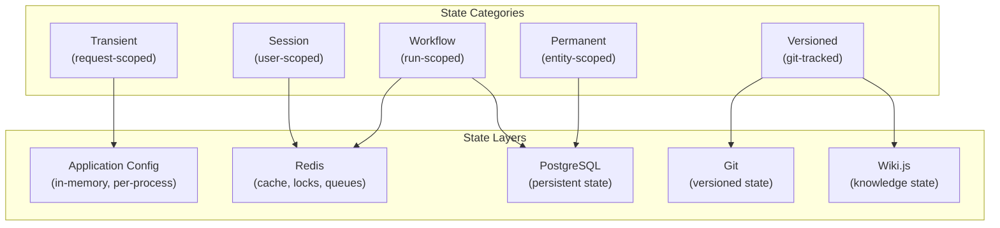
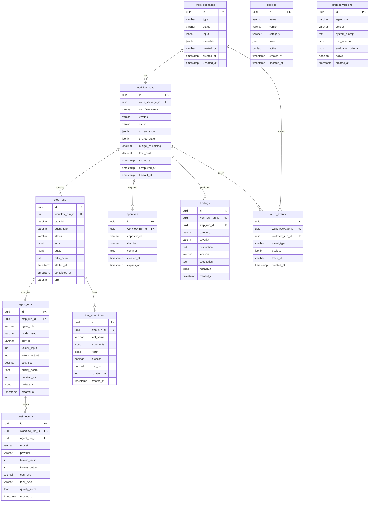

# State Management Design

**Phase:** 1 — Target Architecture
**Date:** 2026-07-13
**Status:** Complete

---

## 1. State Architecture



---

## 2. PostgreSQL Schema Design

### 2.1 Core entities



### 2.2 Indexes

```sql
-- Work packages
CREATE INDEX idx_work_packages_status ON work_packages(status);
CREATE INDEX idx_work_packages_type ON work_packages(type);
CREATE INDEX idx_work_packages_created ON work_packages(created_at);

-- Workflow runs
CREATE INDEX idx_workflow_runs_work_package ON workflow_runs(work_package_id);
CREATE INDEX idx_workflow_runs_status ON workflow_runs(status);
CREATE INDEX idx_workflow_runs_name ON workflow_runs(workflow_name);
CREATE INDEX idx_workflow_runs_started ON workflow_runs(started_at);

-- Step runs
CREATE INDEX idx_step_runs_workflow ON step_runs(workflow_run_id);
CREATE INDEX idx_step_runs_status ON step_runs(status);
CREATE INDEX idx_step_runs_agent ON step_runs(agent_role);

-- Agent runs
CREATE INDEX idx_agent_runs_step ON agent_runs(step_run_id);
CREATE INDEX idx_agent_runs_model ON agent_runs(model_used);
CREATE INDEX idx_agent_runs_created ON agent_runs(created_at);

-- Findings
CREATE INDEX idx_findings_workflow ON findings(workflow_run_id);
CREATE INDEX idx_findings_category ON findings(category);
CREATE INDEX idx_findings_severity ON findings(severity);

-- Approvals
CREATE INDEX idx_approvals_workflow ON approvals(workflow_run_id);
CREATE INDEX idx_approvals_approver ON approvals(approver_id);

-- Cost records
CREATE INDEX idx_cost_workflow ON cost_records(workflow_run_id);
CREATE INDEX idx_cost_model ON cost_records(model);
CREATE INDEX idx_cost_created ON cost_records(created_at);

-- Audit events
CREATE INDEX idx_audit_work_package ON audit_events(workpace_package_id);
CREATE INDEX idx_audit_workflow ON audit_events(workflow_run_id);
CREATE INDEX idx_audit_type ON audit_events(event_type);
CREATE INDEX idx_audit_trace ON audit_events(trace_id);
CREATE INDEX idx_audit_created ON audit_events(created_at);

-- Policies
CREATE INDEX idx_policies_name ON policies(name);
CREATE INDEX idx_policies_active ON policies(active);

-- Prompt versions
CREATE INDEX idx_prompt_role ON prompt_versions(agent_role);
CREATE INDEX idx_prompt_active ON prompt_versions(active);
```

---

## 3. Repository Pattern

### 3.1 Base repository

```python
from typing import Generic, TypeVar, Protocol
from uuid import UUID

T = TypeVar("T")

class Repository(Protocol[T]):
    """Generic repository interface."""

    async def get(self, id: UUID) -> T | None: ...
    async def list(self, filters: dict | None = None) -> list[T]: ...
    async def create(self, entity: T) -> T: ...
    async def update(self, entity: T) -> T: ...
    async def delete(self, id: UUID) -> bool: ...
```

### 3.2 Concrete repositories

| Repository | Entity | Table |
|---|---|---|
| `WorkPackageRepository` | `WorkPackage` | `work_packages` |
| `WorkflowRunRepository` | `WorkflowRun` | `workflow_runs` |
| `StepRunRepository` | `StepRun` | `step_runs` |
| `AgentRunRepository` | `AgentRun` | `agent_runs` |
| `FindingRepository` | `Finding` | `findings` |
| `ApprovalRepository` | `Approval` | `approvals` |
| `CostRepository` | `CostRecord` | `cost_records` |
| `AuditRepository` | `AuditEvent` | `audit_events` |
| `PolicyRepository` | `Policy` | `policies` |
| `PromptVersionRepository` | `PromptVersion` | `prompt_versions` |

---

## 4. Redis Usage

### 4.1 Key patterns

| Pattern | Purpose | TTL |
|---|---|---|
| `lock:workflow:{id}` | Workflow execution lock | 300s |
| `lock:step:{workflow_id}:{step_id}` | Step execution lock | 60s |
| `cache:llm:{hash}` | LLM response cache | 24h |
| `budget:daily:{date}` | Daily cost counter | 24h |
| `budget:workflow:{id}` | Per-workflow cost counter | workflow TTL |
| `queue:workflow:pending` | Pending workflow queue | — |
| `queue:approval:pending` | Pending approval queue | — |

### 4.2 Lock acquisition

```python
async def acquire_lock(self, key: str, ttl: int = 60) -> bool:
    """Acquire a distributed lock with TTL."""
    return await self.redis.set(key, "1", nx=True, ex=ttl)

async def release_lock(self, key: str) -> None:
    """Release a distributed lock."""
    await self.redis.delete(key)
```

---

## 5. Data Retention

### 5.1 Retention policies

| Data | Retention | Action |
|---|---|---|
| Audit events | 90 days | Archive to cold storage |
| Cost records | 1 year | Aggregate monthly, delete daily |
| Workflow runs | 1 year | Archive completed runs |
| Step runs | 1 year | Archive with workflow |
| Agent runs | 1 year | Archive with step |
| Findings | 2 years | Keep for regression analysis |
| Approvals | 2 years | Keep for compliance |
| Tool executions | 30 days | Delete after retention |
| LLM cache (Redis) | 24 hours | Auto-expire |

### 5.2 Archival process

```python
async def archive_old_records(self, days: int = 365):
    """Archive records older than N days."""
    cutoff = datetime.utcnow() - timedelta(days=days)

    # Archive workflow runs
    old_runs = await self.db.fetch(
        "SELECT * FROM workflow_runs WHERE completed_at < $1 AND status = 'completed'",
        cutoff
    )
    await self.archive_to_cold_storage("workflow_runs", old_runs)
    await self.db.execute(
        "DELETE FROM workflow_runs WHERE completed_at < $1 AND status = 'completed'",
        cutoff
    )
```

---

## 6. Migration Strategy

### 6.1 Alembic workflow

```bash
# Create migration
alembic revision --autogenerate -m "add_workflow_tables"

# Apply migration
alembic upgrade head

# Rollback
alembic downgrade -1

# Check current version
alembic current
```

### 6.2 Migration rules

1. **Never drop columns** in production — mark as deprecated.
2. **Always add columns as nullable** or with defaults.
3. **Never rename columns** — add new, migrate data, drop old.
4. **Test migrations** against production-like data volume.
5. **Blue/green deployment** for schema changes.
6. **Rollback script** for every migration.

### 6.3 Version tracking

```sql
-- Alembic version table (auto-created)
CREATE TABLE alembic_version (
    version_num VARCHAR(32) NOT NULL,
    CONSTRAINT alembic_version_pkc PRIMARY KEY (version_num)
);
```
