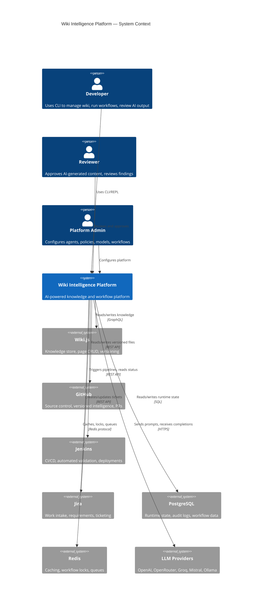
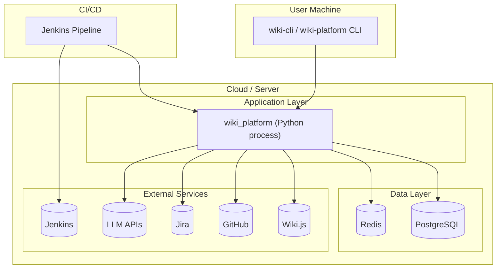

# System Context (C4 Level 1)

**Phase:** 1 — Target Architecture
**Date:** 2026-07-13
**Status:** Complete

---

## 1. Context Diagram

---

## 2. Actor Descriptions

### 2.1 Developer

| Attribute | Value |
|---|---|
| **Role** | Primary user of the platform |
| **Goals** | Generate documentation, manage wiki pages, run AI-assisted workflows |
| **Interactions** | CLI commands, REPL sessions, workflow triggers |
| **Authentication** | Wiki.js API key, GitHub token, Jira token |
| **Frequency** | Daily |

### 2.2 Reviewer

| Attribute | Value |
|---|---|
| **Role** | Approves AI-generated content and findings |
| **Goals** | Ensure quality, accuracy, and policy compliance of AI output |
| **Interactions** | Approval gates, review queues, comments |
| **Authentication** | Wiki.js API key, platform credentials |
| **Frequency** | Weekly or per-workflow |

### 2.3 Platform Admin

| Attribute | Value |
|---|---|
| **Role** | Configures and governs the platform |
| **Goals** | Define agent behavior, set policies, manage costs, monitor health |
| **Interactions** | Git (policies, prompts, workflows), CLI admin commands |
| **Authentication** | Full platform access |
| **Frequency** | As needed |

---

## 3. External System Descriptions

### 3.1 Wiki.js

| Attribute | Value |
|---|---|
| **Type** | Knowledge store |
| **Protocol** | GraphQL over HTTPS |
| **Authentication** | Bearer token (API key) |
| **Data stored** | Pages, revisions, tags, metadata |
| **Criticality** | Critical — primary knowledge store |
| **Failure mode** | Read-only fallback; retry with backoff |

### 3.2 GitHub

| Attribute | Value |
|---|---|
| **Type** | Source control + versioned intelligence |
| **Protocol** | REST API v3 / GraphQL v4 |
| **Authentication** | Personal access token or GitHub App |
| **Data stored** | Prompts, policies, agent definitions, model profiles, workflow defs |
| **Criticality** | Critical — "Git defines intelligence" |
| **Failure mode** | Queue operations, retry on rate limit |

### 3.3 Jenkins

| Attribute | Value |
|---|---|
| **Type** | CI/CD + automated validation |
| **Protocol** | REST API |
| **Authentication** | API token or crumb-based |
| **Data stored** | Pipeline definitions, build artifacts, test results |
| **Criticality** | High — gates all deployments |
| **Failure mode** | Alert on failure, manual trigger fallback |

### 3.4 Jira

| Attribute | Value |
|---|---|
| **Type** | Work intake + requirements |
| **Protocol** | REST API v2/v3 |
| **Authentication** | API token + email |
| **Data stored** | Issues, epics, stories, requirements |
| **Criticality** | Medium — optional integration |
| **Failure mode** | Degraded mode (no Jira sync) |

### 3.5 PostgreSQL

| Attribute | Value |
|---|---|
| **Type** | Runtime state store |
| **Protocol** | SQL over TCP |
| **Authentication** | Username/password or IAM |
| **Data stored** | Workflows, agent runs, findings, approvals, costs, audit logs |
| **Criticality** | Critical — all runtime state |
| **Failure mode** | Platform unavailable; no partial operation |

### 3.6 Redis

| Attribute | Value |
|---|---|
| **Type** | Cache + queue + lock store |
| **Protocol** | Redis protocol |
| **Authentication** | Password or ACL |
| **Data stored** | Workflow locks, LLM response cache, job queues |
| **Criticality** | High — performance and concurrency |
| **Failure mode** | Degrade to no-cache mode; queue operations lost |

### 3.7 LLM Providers

| Attribute | Value |
|---|---|
| **Type** | AI model inference |
| **Protocol** | HTTPS (OpenAI-compatible API) |
| **Authentication** | API key per provider |
| **Data sent** | Prompts, tool schemas, conversation history |
| **Criticality** | Critical — core intelligence |
| **Failure mode** | Fallback to next provider in chain; escalate to human |

---

## 4. Data Flow Summary

| Flow | Source | Destination | Frequency | Volume |
|---|---|---|---|---|
| Page CRUD | Platform | Wiki.js | Per-user action | Low |
| Knowledge sync | Wiki.js | Platform | On-demand or scheduled | Medium |
| Version control | Platform | GitHub | Per-change | Low |
| Pipeline trigger | Platform | Jenkins | Per-workflow | Medium |
| Ticket sync | Platform | Jira | Per-workflow | Low |
| State read/write | Platform | PostgreSQL | Per-operation | High |
| LLM inference | Platform | LLM Providers | Per-agent-step | High |
| Cache read | Platform | Redis | Per-operation | High |

---

## 5. Trust Boundaries

| Boundary | Description |
|---|---|
| **User → Platform** | CLI authentication; API key required for Wiki.js, GitHub, Jira |
| **Platform → External APIs** | HTTPS with API keys; no shared secrets |
| **Platform → Database** | SQL with parameterized queries; no raw SQL in application code |
| **LLM → Platform** | Prompt-injection guardrails; content sanitization before LLM processing |
| **Agent → Agent** | Each agent has bounded permissions; no cross-agent state sharing |
| **Human → Approval** | Destructive operations require human sign-off |

---

## 6. Deployment Context

### Deployment modes

| Mode | Description | Use case |
|---|---|---|
| **Local CLI** | Single-user, runs on developer machine | Day-to-day wiki management |
| **Server mode** | Multi-user, runs on shared server | Team workflows, shared state |
| **Container mode** | Docker/Kubernetes deployment | Production, scaling |
