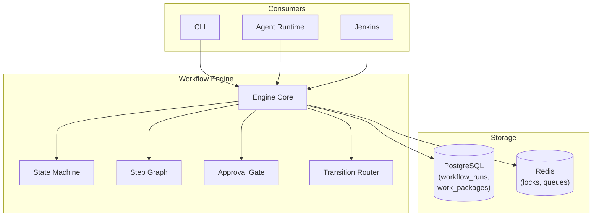
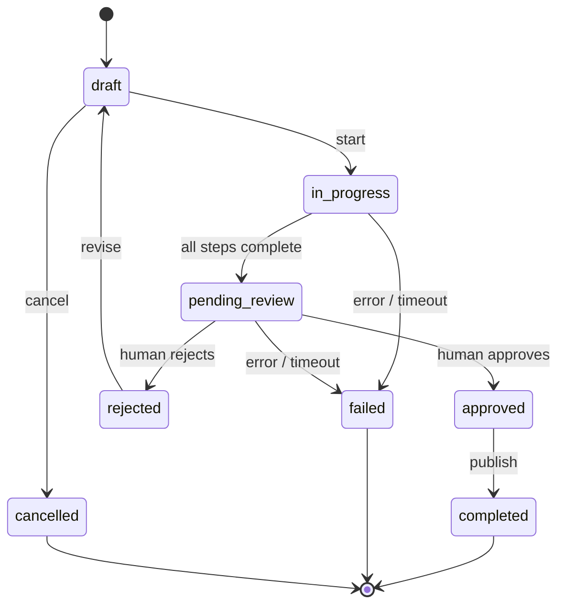
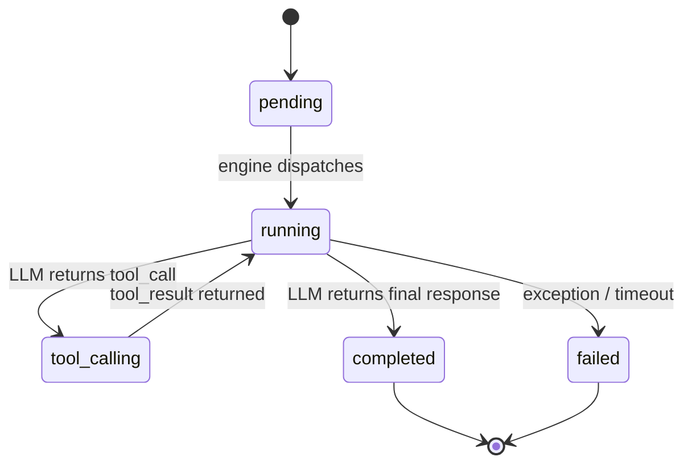
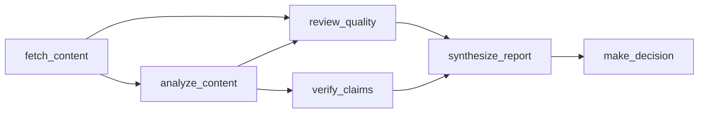
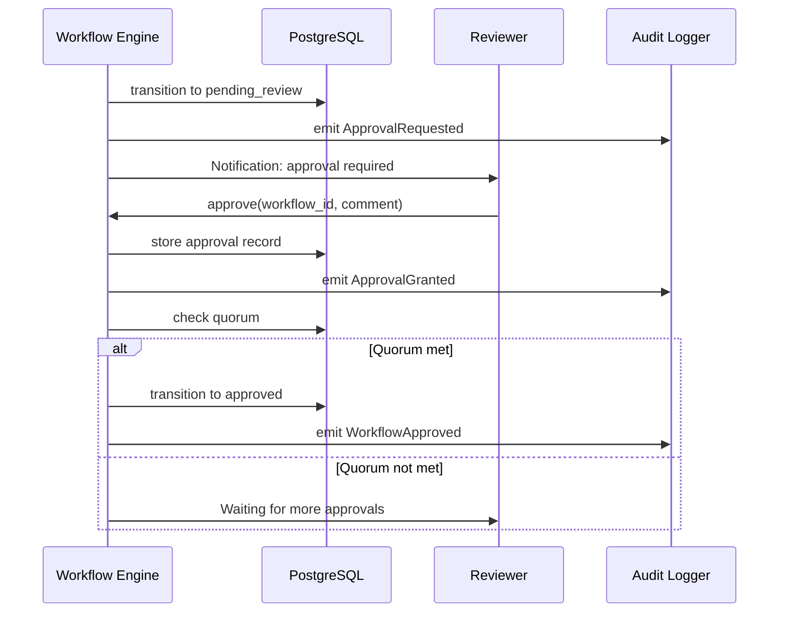

# Workflow Engine Design

**Phase:** 1 — Target Architecture
**Date:** 2026-07-13
**Status:** Complete

---

## 1. Engine Overview



---

## 2. Workflow Definition Format

Workflows are defined in YAML, versioned in Git under `workflows/`.

```yaml
# workflows/doc_review.yaml
name: doc_review
version: 2
description: "Review a Wiki.js page for quality, accuracy, and policy compliance"

# Trigger conditions
triggers:
  - type: manual
  - type: webhook
    path: /api/workflows/doc_review
  - type: schedule
    cron: "0 9 * * 1"  # Weekly on Monday

# Workflow-level configuration
config:
  timeout: 3600
  max_cost: 5.00
  require_approval: true
  approval_role: reviewer

# State machine definition
states:
  - id: draft
    terminal: false
  - id: in_progress
    terminal: false
  - id: pending_review
    terminal: false
    approval_required: true
  - id: approved
    terminal: false
  - id: rejected
    terminal: false
  - id: completed
    terminal: true
  - id: failed
    terminal: true
  - id: cancelled
    terminal: true

# Initial state
initial_state: draft

# Steps (agent tasks)
steps:
  - id: fetch_content
    agent: researcher
    prompt_version: v1
    inputs:
      page_id: "{input.page_id}"
    outputs:
      - page_content
      - page_metadata
    timeout: 60

  - id: analyze_content
    agent: author
    prompt_version: v2
    depends_on: [fetch_content]
    inputs:
      content: "{steps.fetch_content.outputs.page_content}"
      metadata: "{steps.fetch_content.outputs.page_metadata}"
    outputs:
      - analysis
      - findings
    timeout: 120

  - id: review_quality
    agent: critic
    prompt_version: v1
    depends_on: [analyze_content]
    inputs:
      content: "{steps.fetch_content.outputs.page_content}"
      analysis: "{steps.analyze_content.outputs.analysis}"
    outputs:
      - quality_findings
      - quality_score
    timeout: 90

  - id: verify_claims
    agent: verifier
    prompt_version: v1
    depends_on: [analyze_content]
    inputs:
      content: "{steps.fetch_content.outputs.page_content}"
      findings: "{steps.analyze_content.outputs.findings}"
    outputs:
      - verification_report
    timeout: 90

  - id: synthesize_report
    agent: synthesizer
    prompt_version: v1
    depends_on: [review_quality, verify_claims]
    inputs:
      analysis: "{steps.analyze_content.outputs.analysis}"
      quality_findings: "{steps.review_quality.outputs.quality_findings}"
      verification: "{steps.verify_claims.outputs.verification_report}"
    outputs:
      - final_report
    timeout: 120

  - id: make_decision
    agent: judge
    prompt_version: v1
    depends_on: [synthesize_report]
    inputs:
      report: "{steps.synthesize_report.outputs.final_report}"
      quality_score: "{steps.review_quality.outputs.quality_score}"
    outputs:
      - decision
      - reasoning
    timeout: 60

# Transitions
transitions:
  - from: draft
    to: in_progress
    guard: "steps.fetch_content.status == 'started'"

  - from: in_progress
    to: pending_review
    guard: "steps.make_decision.status == 'completed'"

  - from: pending_review
    to: approved
    action: "approval Granted"

  - from: pending_review
    to: rejected
    action: "approval Rejected"

  - from: approved
    to: completed
    action: "publish_results"

  - from: rejected
    to: draft
    action: "reset_for_revision"

  - from: draft
    to: cancelled
    action: "cancel"

  - from: any
    to: failed
    guard: "error != null"
```

---

## 3. State Machine

### 3.1 States



### 3.2 State properties

| State | Terminal | Approval required | Can retry | Can cancel |
|---|---|---|---|---|
| `draft` | No | No | No | Yes |
| `in_progress` | No | No | No | Yes |
| `pending_review` | No | Yes | No | Yes |
| `approved` | No | No | No | No |
| `rejected` | No | No | No | No |
| `completed` | Yes | No | No | No |
| `failed` | Yes | No | Yes (from failed) | No |
| `cancelled` | Yes | No | Yes (from cancelled) | No |

---

## 4. Step Execution

### 4.1 Step lifecycle



### 4.2 Step execution flow

```python
async def execute_step(self, step: StepDefinition, context: WorkflowContext):
    """Execute a single workflow step."""
    # 1. Acquire lock
    lock = await self.redis.lock(f"step:{step.id}:{context.workflow_id}")

    # 2. Update state
    await self.db.update_step_status(step.id, "running")

    # 3. Emit event
    await self.audit.emit(StepStarted(workflow_id=context.workflow_id, step_id=step.id))

    try:
        # 4. Resolve inputs
        inputs = self._resolve_inputs(step.inputs, context)

        # 5. Create agent context
        agent_context = AgentContext(
            workflow_id=context.workflow_id,
            work_package_id=context.work_package_id,
            step_index=step.index,
            shared_state=context.shared_state,
            previous_results=context.previous_results,
            policy_constraints=context.policies,
            budget_remaining=context.budget_remaining,
        )

        # 6. Instantiate agent
        agent = self.agent_registry.create(step.agent, step.prompt_version)

        # 7. Run agent
        result = await agent.run(inputs, agent_context)

        # 8. Store result
        await self.db.store_step_result(step.id, result)
        context.previous_results.append(result)
        context.shared_state.update(result.findings)

        # 9. Update state
        await self.db.update_step_status(step.id, "completed")

        # 10. Emit event
        await self.audit.emit(StepCompleted(workflow_id=context.workflow_id, step_id=step.id, result=result))

    except Exception as e:
        await self.db.update_step_status(step.id, "failed", error=str(e))
        await self.audit.emit(StepFailed(workflow_id=context.workflow_id, step_id=step.id, error=str(e)))
        raise

    finally:
        await lock.release()
```

---

## 5. Dependency Resolution

### 5.1 Step graph

Steps form a DAG (directed acyclic graph). The engine resolves execution order:



### 5.2 Parallel execution

Steps with no dependencies between them can execute in parallel:

```python
def get_ready_steps(self, workflow: Workflow) -> list[Step]:
    """Return steps whose dependencies are all completed."""
    return [
        step for step in workflow.steps
        if step.status == "pending"
        and all(
            workflow.get_step(dep).status == "completed"
            for dep in step.depends_on
        )
    ]
```

---

## 6. Approval Gates

### 6.1 Approval types

| Type | Description | Quorum |
|---|---|---|
| `single` | One approver required | 1 |
| `multi` | Multiple approvers required | N of M |
| `role` | Approver must have specific role | 1 with role |
| `quorum` | Majority of approvers required | > 50% |

### 6.2 Approval flow



### 6.3 Approval record

```python
@dataclass
class ApprovalRecord:
    id: UUID
    workflow_id: UUID
    step_id: UUID
    approver_id: str
    decision: str  # "approved" | "rejected"
    comment: str
    timestamp: datetime
    expires_at: datetime | None
```

---

## 7. Workflow Examples

### 7.1 Document Review Workflow

| Step | Agent | Input | Output |
|---|---|---|---|
| 1 | Researcher | Page ID | Page content + metadata |
| 2 | Author | Page content | Analysis + findings |
| 3 | Critic | Page content + analysis | Quality findings + score |
| 4 | Verifier | Page content + findings | Verification report |
| 5 | Synthesizer | All previous outputs | Final report |
| 6 | Judge | Final report + quality score | Decision + reasoning |

**Trigger:** Manual or scheduled (weekly)
**Approval:** Required (reviewer role)
**Cost cap:** $5.00
**Timeout:** 3600s

### 7.2 Requirements Review Workflow

| Step | Agent | Input | Output |
|---|---|---|---|
| 1 | Researcher | Jira epic ID | Requirements + context |
| 2 | Author | Requirements | Structured requirements document |
| 3 | Critic | Requirements doc | Issues + suggestions |
| 4 | Verifier | Requirements + issues | Verification against existing code |
| 5 | Judge | All findings | Approval decision |

**Trigger:** Jira webhook on epic creation
**Approval:** Required (product owner role)
**Cost cap:** $3.00

### 7.3 Weekly Improvement Workflow

| Step | Agent | Input | Output |
|---|---|---|---|
| 1 | Evidence Collector | Time range | Work evidence from Git, Jira, Wiki |
| 2 | Author | Evidence | Weekly summary |
| 3 | Critic | Summary + evidence | Quality review |
| 4 | Synthesizer | All outputs | Improvement recommendations |
| 5 | Judge | Recommendations | Prioritized action items |

**Trigger:** Scheduled (Friday 5 PM)
**Approval:** Required (team lead role)
**Cost cap:** $4.00

---

## 8. Error Handling

| Error type | Strategy |
|---|---|
| Agent timeout | Mark step failed, retry if retries remaining |
| Agent exception | Mark step failed, log error, continue if optional step |
| LLM API error | Try fallback model, then mark step failed |
| Budget exceeded | Stop workflow, mark as `failed` with reason |
| Policy violation | Block action, require human override |
| Lock timeout | Retry with backoff, fail after 3 attempts |
| Database error | Retry, fail workflow after 3 attempts |

---

## 9. Observability

Every workflow operation emits structured events:

| Event | Fields |
|---|---|
| `WorkflowStarted` | workflow_id, type, triggered_by, timestamp |
| `StepStarted` | workflow_id, step_id, agent_role, model |
| `StepCompleted` | workflow_id, step_id, score, tokens, cost, duration |
| `StepFailed` | workflow_id, step_id, error, stack_trace |
| `ApprovalRequested` | workflow_id, step_id, approvers |
| `ApprovalGranted` | workflow_id, step_id, approver_id, comment |
| `WorkflowCompleted` | workflow_id, total_cost, total_duration, final_state |
